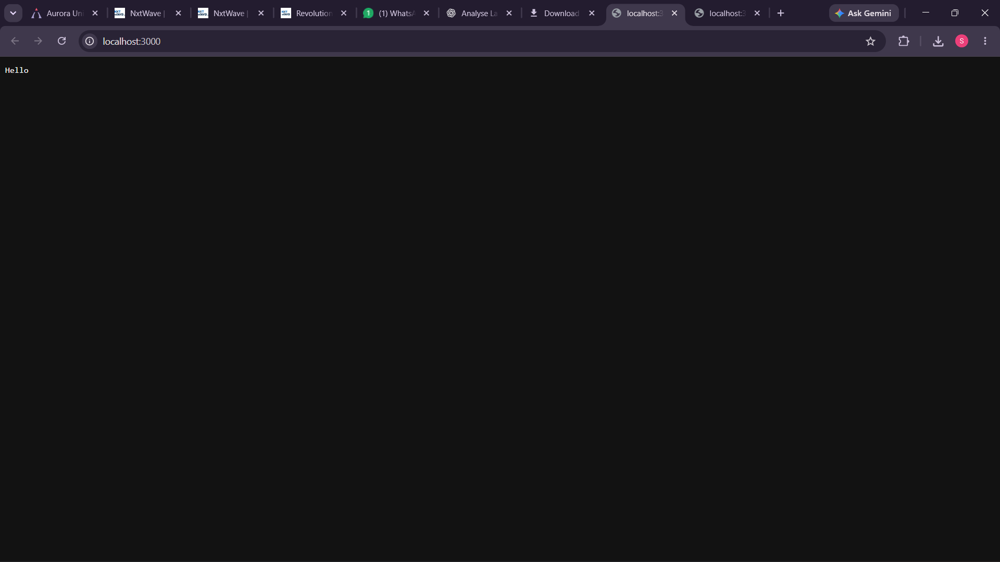
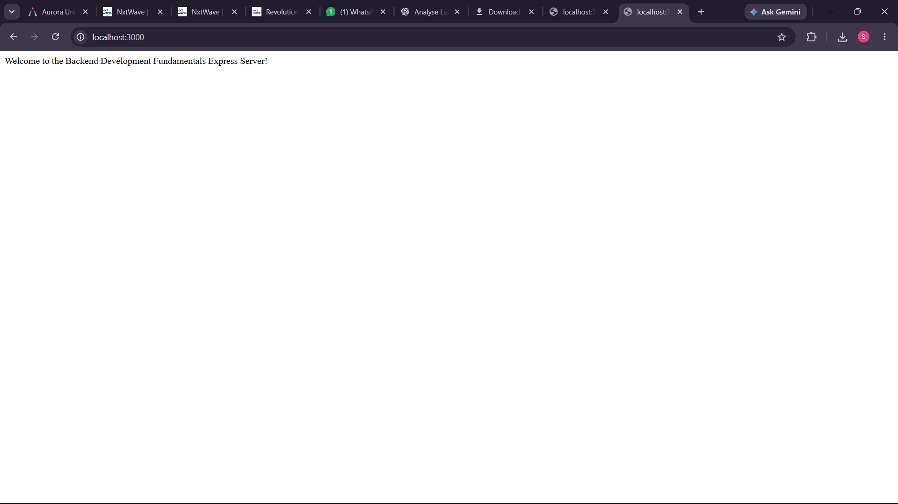
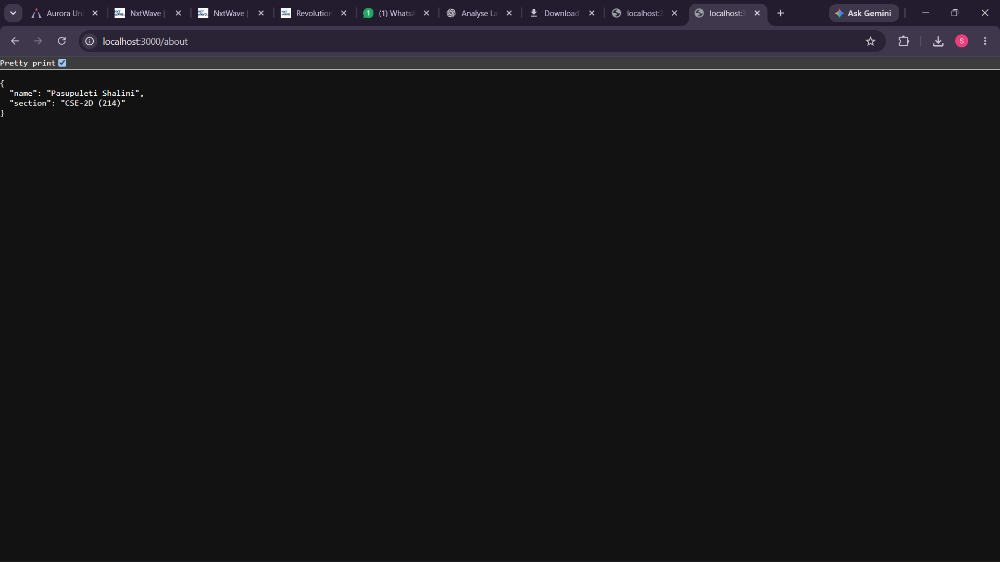
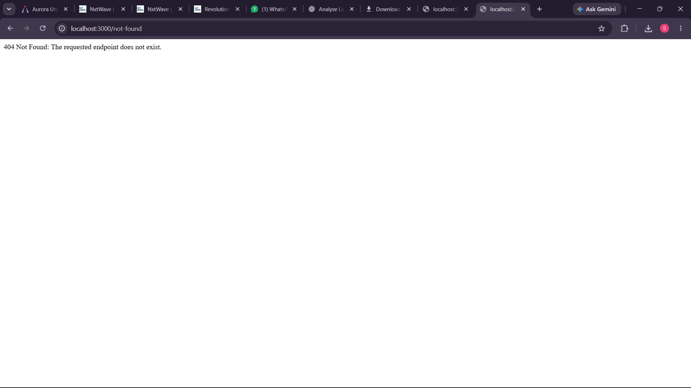

# Lab 01 – Node.js and Express Server
**Course:** Backend Development Fundamentals

---

## Student Information

- **Student Name:** Pasupuleti Shalini
- **Registration / Roll No:** 252U1R1185
- **Class & Section:** CSE-2D (214)

---

## 1. Objective

The primary objectives of this lab are:
1. To understand the fundamental concepts of backend server development in Node.js.
2. To create and configure a low-level HTTP web server using Node.js's built-in `http` module.
3. To learn the advantages of using the Express.js framework over the built-in HTTP module for building web applications.
4. To implement routing in Express for different endpoints (`/`, `/about`, `/time`).
5. To return appropriate data formats, including plain text and JSON.
6. To implement a custom 404 error-handling middleware for unknown routes.
7. To understand and apply proper HTTP status codes (`200 OK`, `404 Not Found`).
8. To manage project configurations, npm scripts, and dependencies using `package.json`.

---

## 2. Technologies Used

- **Runtime Environment:** [Node.js](https://nodejs.org/) (JavaScript Runtime)
- **Framework:** [Express.js](https://expressjs.com/) (v5.x)
- **Module System:** CommonJS (`require` / `module.exports`)
- **Package Manager:** npm (Node Package Manager)
- **Version Control:** Git

---

## 3. Project Structure

All files for Lab 01 are located inside the `lab-01/` directory:

```text
Backend_Development_Fundamentals/
└── lab-01/
    ├── .gitignore           # Excludes node_modules and sensitive files
    ├── http-server.js       # Plain Node.js HTTP server (built-in http module)
    ├── server.js            # Express server with routes & 404 middleware
    ├── package.json         # Project metadata, scripts, and dependencies
    ├── package-lock.json    # Dependency lockfile
    ├── README.md            # Lab documentation and guide
    ├── node_modules/        # Installed dependencies (Express)
    └── screenshots/         # Output screenshots for submission
```

---

## 4. Installation & Setup

1. Open your terminal or command prompt.
2. Navigate to the `lab-01` directory:
   ```bash
   cd lab-01
   ```
3. Since dependencies (Express) are already installed in `node_modules`, you do **not** need to reinstall them. However, if you ever clone this repository fresh on another computer, install the dependencies with:
   ```bash
   npm install
   ```

---

## 5. Execution Commands

> **Important Note on Ports:** Both `http-server.js` and `server.js` listen on port `3000`. Please test them one at a time. Stop a running server using `Ctrl + C` in the terminal before starting the other.

### 5.1 Running the Plain Node.js HTTP Server

Using the npm script:
```bash
npm run start:http
```
Or directly using Node.js:
```bash
node http-server.js
```
The server will start and log:
```text
Plain Node.js HTTP Server is running at http://localhost:3000
```

### 5.2 Running the Express Server

Using the npm script:
```bash
npm start
```
Or directly using Node.js:
```bash
node server.js
```
The server will start and log:
```text
Express Server is running at http://localhost:3000
```

---

## 6. Endpoint Documentation

### 6.1 Plain Node.js Server (`http-server.js`)

| HTTP Method | Endpoint URL | Description | Response Type | Status Code |
| :--- | :--- | :--- | :--- | :--- |
| `GET` | `http://localhost:3000/` | Base route responding with greeting | `text/plain` | `200 OK` |

**Sample Response:**
```text
Hello
```

---

### 6.2 Express Server (`server.js`)

| HTTP Method | Endpoint URL | Description | Response Type | Status Code |
| :--- | :--- | :--- | :--- | :--- |
| `GET` | `http://localhost:3000/` | Welcome message | `text/plain` | `200 OK` |
| `GET` | `http://localhost:3000/about` | Student name and section | `application/json` | `200 OK` |
| `GET` | `http://localhost:3000/time` | Current date and time | `text/plain` | `200 OK` |
| `GET` | `http://localhost:3000/anything` | Fallback for any unknown route | `text/plain` | `404 Not Found` |

#### Endpoint Details & Sample Responses

1. **`GET /`**
   - **Status Code:** `200 OK`
   - **Response Body:**
     ```text
     Welcome to the Backend Development Fundamentals Express Server!
     ```

2. **`GET /about`**
   - **Status Code:** `200 OK`
   - **Response Body (JSON):**
     ```json
     {
       "name": "Pasupuleti Shalini",
       "section": "CSE-2D (214)"
     }
     ```

3. **`GET /time`**
   - **Status Code:** `200 OK`
   - **Response Body:**
     ```text
     Sat Oct 31 2026 11:45:00 GMT+0530 (India Standard Time)
     ```

4. **`GET /unknown` (404 Middleware)**
   - **Status Code:** `404 Not Found`
   - **Response Body:**
     ```text
     404 Not Found: The requested endpoint does not exist.
     ```

---

## 7. Output Screenshots

Save your test screenshots into the `lab-01/screenshots/` folder. The markdown image links below will display your screenshots in this report:

### Screenshot 1: Plain Node.js HTTP Server (`http-server.js`)
*Response: "Hello" at `http://localhost:3000`*



---

### Screenshot 2: Express Server – Root Route (`GET /`)
*Response: Welcome message at `http://localhost:3000/`*



---

### Screenshot 3: Express Server – About Route (`GET /about`)
*Response: JSON object containing student name and section at `http://localhost:3000/about`*



---

### Screenshot 4: Express Server – Time Route (`GET /time`)
*Response: Current date and time at `http://localhost:3000/time`*


---

### Screenshot 5: Express Server – 404 Route (`GET /unknown`)
*Response: 404 Not Found error message at `http://localhost:3000/invalid-route`*



---

## 8. Explanation of `package.json` Fields

The `package.json` file serves as the manifest for Node.js projects. Below is an explanation of each field present in `lab-01/package.json`:

- **`name`**: Specifies the package/project name (`"lab-01"`).
- **`version`**: The current semantic version of the project (`"1.0.0"`).
- **`description`**: An optional textual description of the project.
- **`main`**: The primary entry point file of the application (`"index.js"`).
- **`scripts`**: A dictionary containing shortcut terminal commands:
  - `"start": "node server.js"`: Runs the Express server using `npm start`.
  - `"start:http": "node http-server.js"`: Runs the plain Node.js server using `npm run start:http`.
  - `"test"`: Placeholder script for running automated tests.
- **`keywords`**: An array of keywords for cataloging the package on npm registries.
- **`author`**: The creator or maintainer of the project.
- **`license`**: The licensing terms under which the code is released (`"ISC"`).
- **`type`**: Declares the module system. `"commonjs"` instructs Node.js to use `require()` and `module.exports` instead of ES modules (`import`/`export`).
- **`dependencies`**: Lists external production packages installed via npm and required by the app to run:
  - `"express": "^5.3.0"`: Installs Express.js version 5.3.0 (or compatible minor/patch releases indicated by `^`).

---

## 9. Problems Faced and Solutions

### Problem 1: Port Conflict (`EADDRINUSE: address already in use :::3000`)
- **Cause:** Attempting to run both `http-server.js` and `server.js` simultaneously, or trying to start a server when a previous instance is still running in the background.
- **Solution:** Both servers are configured to listen on port `3000`. Before starting one server, terminate any running instance by pressing `Ctrl + C` in the terminal. On Windows, any stuck process on port 3000 can be located and terminated using:
  ```powershell
  netstat -ano | findstr :3000
  taskkill /PID <PID_NUMBER> /F
  ```

### Problem 2: 404 Middleware Intercepting Valid Routes
- **Cause:** If the 404 error handler middleware (`app.use(...)`) is placed *above* the route definitions (`app.get(...)`), all incoming requests trigger the 404 handler immediately and never reach the intended route handlers.
- **Solution:** In Express, middleware functions execute sequentially in the order they are defined. The 404 handler must always be placed at the very bottom of the file, after all route definitions, so it only catches requests that didn't match any route.

### Problem 3: Browser Hanging on Plain HTTP Server
- **Cause:** In plain Node.js (`http-server.js`), calling `res.write()` without calling `res.end()`, or omitting `res.end()` entirely, leaves the HTTP connection open.
- **Solution:** Always call `res.end('Hello')` to signal to the client/browser that the complete response has been sent and the stream is closed.

### Problem 4: Returning JSON vs. Plain Text
- **Cause:** When returning JSON via plain `res.send(...)` without proper formatting, the client might receive unexpected data or wrong `Content-Type` headers.
- **Solution:** Used `res.status(200).json({ ... })` for the `/about` endpoint. Express automatically serializes JavaScript objects into formatted JSON strings and sets the HTTP header to `Content-Type: application/json; charset=utf-8`.

