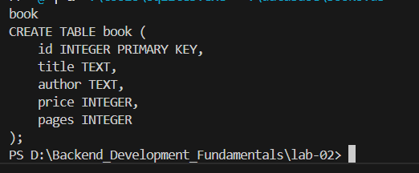
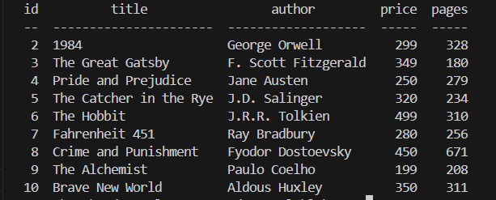
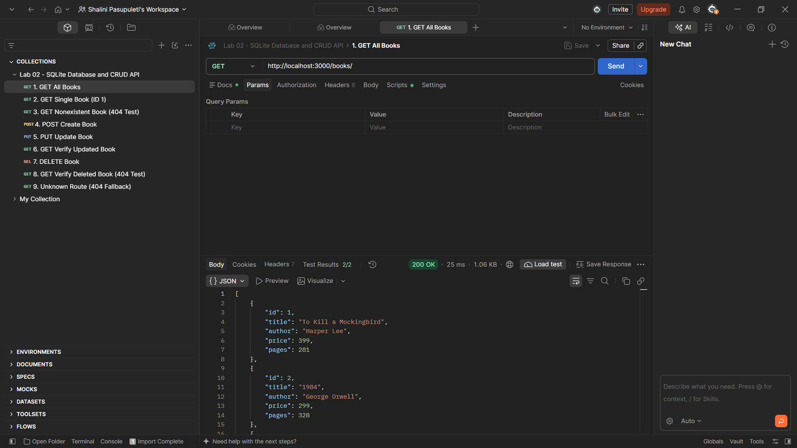
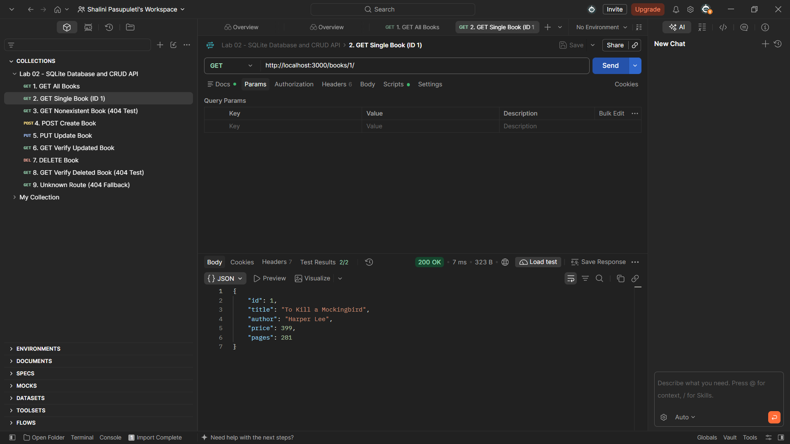
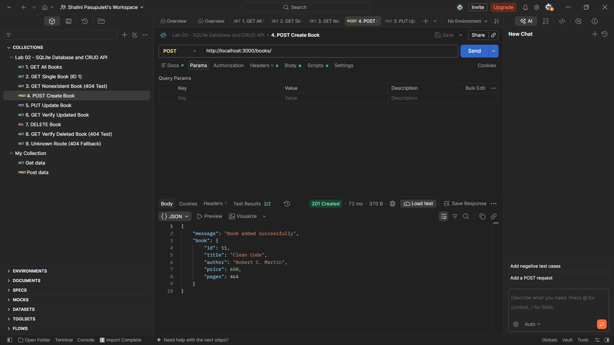
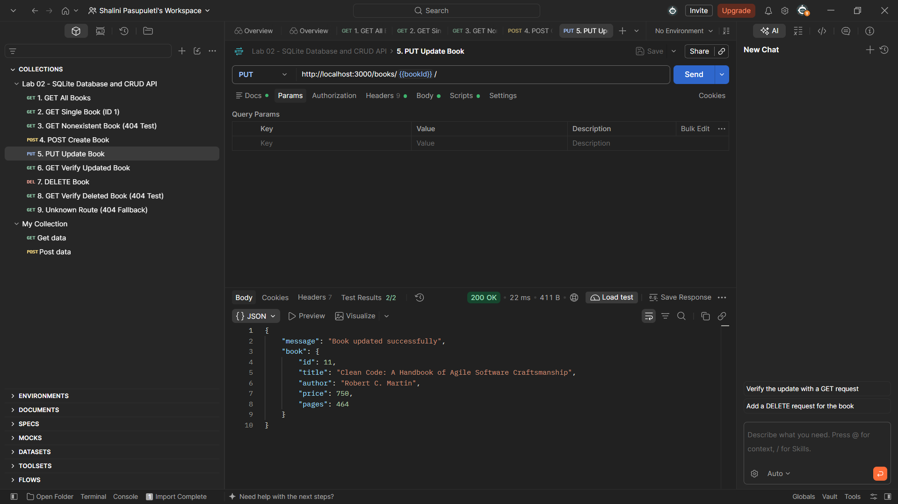
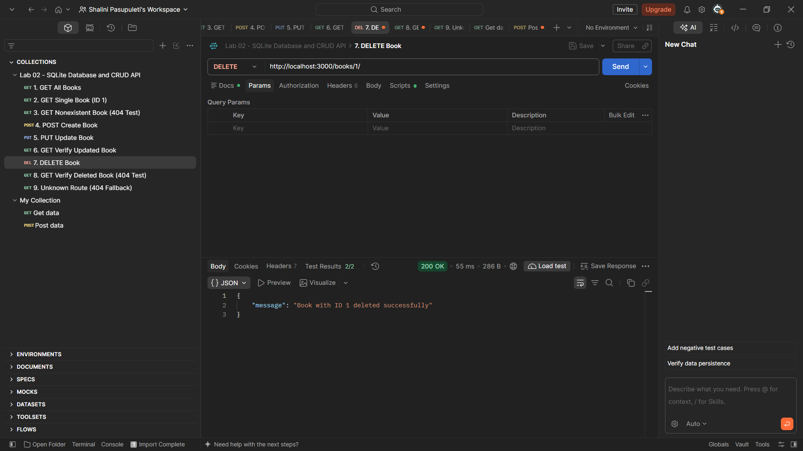
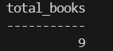
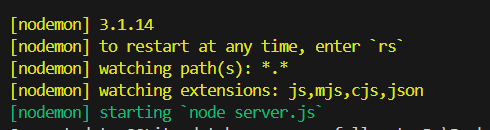

# Lab 02 – SQLite Database and CRUD Routes
**Course:** Backend Development Fundamentals

---

## Student Information

- **Student Name:** Pasupuleti Shalini
- **Registration / Roll No:** 252U1R1185
- **Class & Section:** CSE-2D (214)

---

## 1. Objective

The primary objectives of this lab are:
1. To understand relational database management concepts in backend web applications using SQLite.
2. To configure and connect an embedded, file-based SQLite database with a Node.js and Express server.
3. To design and create a `book` database table schema using the SQLite Command Line Interface (CLI).
4. To implement complete CRUD (Create, Read, Update, Delete) routes mapped to RESTful HTTP methods:
   - `GET /books/`: Retrieve all books.
   - `GET /books/:bookId/`: Retrieve a single book by its ID.
   - `POST /books/`: Insert a new book record into the database.
   - `PUT /books/:bookId/`: Update an existing book's details.
   - `DELETE /books/:bookId/`: Delete a book record by its ID.
5. To use parameterized SQL queries (`?` placeholders) to prevent SQL injection vulnerabilities.
6. To structure API responses with proper HTTP status codes (`200 OK`, `201 Created`, `400 Bad Request`, `404 Not Found`, `500 Internal Server Error`).
7. To configure automatic server restarting during development using `nodemon`.

---

## 2. Technologies Used

- **Runtime Environment:** [Node.js](https://nodejs.org/) (v24.x)
- **Framework:** [Express.js](https://expressjs.com/) (v5.x)
- **Database:** SQLite3
- **Libraries:**
  - `sqlite`: Promise-based SQLite client wrapper for Node.js
  - `sqlite3`: Native SQLite3 driver bindings
  - `nodemon`: Development tool that monitors code changes and automatically restarts the server
- **Hosting / Deployment Target:** [Render](https://render.com/) (Free Web Service)
- **Command Line Tool:** Official SQLite CLI (`sqlite3.exe`)
- **API Testing:** Postman & Node.js HTTP Test Suite

---

## 3. Project Structure

```text
Backend_Development_Fundamentals/
└── lab-02/
    ├── database/
    │   ├── books.db                    # Local SQLite database file containing the book table
    │   └── schema.sql                  # Table schema and 10 sample book records
    ├── screenshots/                    # Output screenshots for submission
    │   ├── 01-database-creation.png
    │   ├── 02-sample-records.png
    │   ├── 03-get-all-books.png
    │   ├── 04-get-single-book.png
    │   ├── 05-post-book.png
    │   ├── 06-put-book.png
    │   ├── 07-delete-book.png
    │   ├── 08-database-verification.png
    │   └── 09-nodemon-server.png
    ├── tools/                          # Official SQLite CLI tools (ignored by Git)
    ├── .gitignore                      # Excludes node_modules, tools/, and .env
    ├── Lab-02-Postman-Collection.json  # Importable Postman collection for all CRUD tests
    ├── package.json                    # Project dependencies and npm scripts
    ├── package-lock.json               # Dependency lockfile
    ├── README.md                       # Comprehensive lab documentation
    ├── server.js                       # Express server with direct SQLite connection & CRUD routes
    ├── test-endpoints.js               # Automated local HTTP endpoint test suite
    └── vercel.json                     # Vercel deployment configuration
```

---

## 4. Installation & Setup

1. Open your terminal and navigate to the `lab-02` directory:
   ```powershell
   cd d:\Backend_Development_Fundamentals\lab-02
   ```

2. Install the project dependencies (if not already installed):
   ```powershell
   npm.cmd install
   ```

---

## 5. Database Creation & Sample Data

The database table was created using the official SQLite CLI tool and the schema defined in [`database/schema.sql`](file:///d:/Backend_Development_Fundamentals/lab-02/database/schema.sql):

### Table Schema:
```sql
CREATE TABLE IF NOT EXISTS book (
    id INTEGER PRIMARY KEY,
    title TEXT,
    author TEXT,
    price INTEGER,
    pages INTEGER
);
```

### Initial Sample Records:
10 sample records were inserted into `database/books.db`:
1. *To Kill a Mockingbird* | Harper Lee | ₹399 | 281 pages
2. *1984* | George Orwell | ₹299 | 328 pages
3. *The Great Gatsby* | F. Scott Fitzgerald | ₹349 | 180 pages
4. *Pride and Prejudice* | Jane Austen | ₹250 | 279 pages
5. *The Catcher in the Rye* | J.D. Salinger | ₹320 | 234 pages
6. *The Hobbit* | J.R.R. Tolkien | ₹499 | 310 pages
7. *Fahrenheit 451* | Ray Bradbury | ₹280 | 256 pages
8. *Crime and Punishment* | Fyodor Dostoevsky | ₹450 | 671 pages
9. *The Alchemist* | Paulo Coelho | ₹199 | 208 pages
10. *Brave New World* | Aldous Huxley | ₹350 | 311 pages

To inspect the database using SQLite CLI:
```powershell
.\tools\sqlite3.exe database/books.db ".schema book" "SELECT * FROM book;"
```

---

## 6. Execution Commands

### 6.1 Running in Development Mode with `nodemon`
`nodemon` automatically restarts the Express server whenever you edit and save any code file:
```powershell
npm.cmd run dev
```

### 6.2 Running in Standard Mode
```powershell
npm.cmd start
```

### 6.3 Running Automated Test Suite
To execute the automated end-to-end CRUD test suite verifying all 10 test scenarios:
```powershell
node.exe test-endpoints.js
```

---

## 7. Endpoint Documentation

| # | HTTP Method | Endpoint URL | Description | Request Body | Expected Status |
| :-: | :--- | :--- | :--- | :--- | :--- |
| **0** | `GET` | `/` | API Information and student details | None | `200 OK` |
| **1** | `GET` | `/books/` | Retrieve all books from the database | None | `200 OK` |
| **2** | `GET` | `/books/:bookId/` | Retrieve a single book by its primary ID | None | `200 OK` / `404 Not Found` |
| **3** | `POST` | `/books/` | Insert a new book record | JSON Object | `201 Created` / `400 Bad Request` |
| **4** | `PUT` | `/books/:bookId/` | Update an existing book's details | JSON Object | `200 OK` / `404 Not Found` |
| **5** | `DELETE`| `/books/:bookId/` | Remove a book record by its ID | None | `200 OK` / `404 Not Found` |

---

## 8. Sample Request & Response Bodies

### 8.1 `POST /books/` (Create New Book)

**Request Body:**
```json
{
  "title": "Clean Code",
  "author": "Robert C. Martin",
  "price": 650,
  "pages": 464
}
```

**Response (Status: `201 Created`):**
```json
{
  "message": "Book added successfully",
  "book": {
    "id": 11,
    "title": "Clean Code",
    "author": "Robert C. Martin",
    "price": 650,
    "pages": 464
  }
}
```

---

### 8.2 `PUT /books/11/` (Update Book)

**Request Body:**
```json
{
  "title": "Clean Code: A Handbook of Agile Software Craftsmanship",
  "author": "Robert C. Martin",
  "price": 750,
  "pages": 464
}
```

**Response (Status: `200 OK`):**
```json
{
  "message": "Book updated successfully",
  "book": {
    "id": 11,
    "title": "Clean Code: A Handbook of Agile Software Craftsmanship",
    "author": "Robert C. Martin",
    "price": 750,
    "pages": 464
  }
}
```

---

### 8.3 `DELETE /books/11/` (Delete Book)

**Response (Status: `200 OK`):**
```json
{
  "message": "Book with ID 11 deleted successfully"
}
```

---

### 8.4 `GET /books/999/` (Nonexistent Book Error)

**Response (Status: `404 Not Found`):**
```json
{
  "error": "Book with ID 999 not found"
}
```

---

## 9. Output Screenshots

Below are the verified screenshots of the SQLite CLI setup, Express server monitoring via nodemon, and CRUD endpoint execution from Postman.

### Screenshot 1: SQLite Database & Table Creation
*Execution of table creation in SQLite CLI showing the `book` schema with `id`, `title`, `author`, `price`, and `pages`.*



---

### Screenshot 2: Sample Book Records in SQLite CLI
*Querying the initial 10 records from the `book` table in SQLite CLI.*



---

### Screenshot 3: GET All Books (`GET /books/`)
*Postman test executing `GET http://localhost:3000/books/`, returning HTTP 200 OK with the array of books and passing all test assertions.*



---

### Screenshot 4: GET Single Book (`GET /books/1/`)
*Postman test executing `GET http://localhost:3000/books/1/`, returning HTTP 200 OK with book ID 1 ("To Kill a Mockingbird").*



---

### Screenshot 5: POST New Book (`POST /books/`)
*Postman test inserting a new book ("Clean Code"), returning HTTP 201 Created and dynamically saving `bookId` as 11.*



---

### Screenshot 6: PUT Updated Book (`PUT /books/{{bookId}}/`)
*Postman test updating book ID 11 with new title and price, returning HTTP 200 OK with the updated record.*



---

### Screenshot 7: DELETE Book (`DELETE /books/{{bookId}}/`)
*Postman test deleting the created book record, returning HTTP 200 OK with confirmation message.*



---

### Screenshot 8: Final Database Verification
*SQLite CLI terminal verification confirming the final book record count.*



---

### Screenshot 9: Server Running with Nodemon
*Terminal output showing `nodemon` active on `server.js` and successfully connected to `database/books.db` on port 3000.*



---

## 10. Problems Faced & Solutions

### Problem 1: Distinction Between `sqlite3` npm Package and SQLite CLI
- **Cause:** The `sqlite3` npm package provides Node.js native language bindings, but does not provide the interactive command-line executable (`sqlite3.exe`) required for manual CLI table creation and inspection.
- **Solution:** Obtained the official 64-bit Windows SQLite command-line tools bundle directly from [sqlite.org](https://www.sqlite.org/download.html), placed the binary in a local `tools/` folder, and added `tools/` and `*.exe` to `.gitignore`.

### Problem 2: Preventing SQL Injection in CRUD Routes
- **Cause:** Concatenating user inputs directly into SQL strings (e.g., `WHERE id = ${bookId}`) leaves the database vulnerable to SQL injection attacks.
- **Solution:** Used parameterized queries with `?` placeholders (e.g., `SELECT * FROM book WHERE id = ?;` with `[bookId]`). The SQLite engine properly sanitizes and binds the parameters before execution.

### Problem 3: Server Starting Before Database Connection Was Ready
- **Cause:** SQLite operations in Node.js are asynchronous. If `app.listen()` is called before `open()` resolves, early incoming requests crash due to `db` being `null`.
- **Solution:** Implemented the asynchronous `initializeDBAndServer()` function to `await open(...)` before starting the server, ensuring the database connection is fully active before listening for requests.

### Problem 4: Ephemeral Filesystem Considerations on Free Cloud Hosting (Render Free)
- **Cause:** Render Free hosts applications as a Web Service running inside a containerized Linux instance. The instance filesystem is ephemeral and lacks an attached persistent disk on the free plan. While the committed SQLite file (`database/books.db`) functions normally with read and write operations during the active lifecycle of the container, any runtime modifications (such as newly inserted books or edits) will reset to the original repository state whenever the service restarts, spins down after 15 minutes of inactivity, or redeploys.
- **Solution:** For academic coursework and lab evaluation, having the application load the committed `database/books.db` file (with all 10 canonical sample records) ensures a reliable, repeatable initial state with zero external credentials or dependencies. In a production enterprise system requiring persistent relational storage across restarts, a managed cloud database (such as PostgreSQL) or an attached persistent disk would be provisioned.

---

## 11. Deployment Architecture & Status (Render Free)

- **Deployment Status:** Local implementation 100% complete, tested, and verified. Configured for single-service deployment on **Render Free Web Services**. Live deployment URL is **Pending user deployment**.
- **Application Architecture:**
  - Single Express application with direct, embedded SQLite (`database/books.db`).
  - Uses native `sqlite` and `sqlite3` packages.
  - Dynamically listens on `process.env.PORT || 3000`.
  - Fully compatible with Render's Ubuntu/Debian Linux container runtime.

### 11.1 Ephemeral Storage Notice

> [!WARNING]
> **Render Free Plan Uses Ephemeral Storage:**
> Render Free Web Services run in containerized environments without attached persistent disk storage.
> - **Runtime Functionality:** When running, all 5 CRUD operations (`GET`, `POST`, `PUT`, `DELETE`) work as expected on `database/books.db`.
> - **Inactivity & Restarts:** On Render Free, services automatically spin down (sleep) after 15 minutes of inactivity. When a new request arrives, Render spins up a fresh container instance from your Git repository.
> - **Data Reset:** Any modifications made at runtime (such as newly added books or deletions) will reset back to the committed `database/books.db` file (the 10 original sample records) upon redeployment or cold restarts. Persistent cloud storage is not provided or claimed on this free tier.

### 11.2 Render Dashboard Configuration Settings

When creating the Web Service on [Render](https://render.com/), use the following exact settings:

| Setting Field | Configuration Value | Notes |
| :--- | :--- | :--- |
| **Service Type** | `Web Service` | Standard Node.js web server |
| **Repository** | `https://github.com/pasupuletishalini/Backend_Development_Fundamentals` | Your connected GitHub repo |
| **Root Directory** | `lab-02` | **Crucial:** Directs Render to build inside `lab-02` |
| **Environment / Runtime** | `Node` | Node.js v20+ / v22+ / v24+ |
| **Build Command** | `npm install` | Installs `express`, `sqlite`, and `sqlite3` |
| **Start Command** | `node server.js` | Alternatively: `npm start` |
| **Instance Type** | `Free` | Free tier ($0/month) |
| **Environment Variables** | *None required* | Render automatically injects `PORT` |

### 11.3 Step-by-Step Deployment Instructions

1. **Push Changes to GitHub:**
   ```powershell
   git add lab-02
   git commit -m "feat(lab-02): prepare single SQLite Express app for Render deployment"
   git push origin main
   ```

2. **Create New Web Service on Render:**
   - Log into [dashboard.render.com](https://dashboard.render.com/).
   - Click **New +** > **Web Service**.
   - Select your repository `pasupuletishalini/Backend_Development_Fundamentals`.

3. **Configure the Service Details:**
   - Set **Name:** `backend-fundamentals-lab-02` (or your preferred name).
   - Set **Root Directory:** `lab-02`.
   - Set **Runtime:** `Node`.
   - Set **Build Command:** `npm install`.
   - Set **Start Command:** `node server.js`.
   - Select the **Free** instance plan.

4. **Deploy and Test:**
   - Click **Create Web Service**.
   - Wait 2–3 minutes for Render to install dependencies, run `node server.js`, and transition the status to **Live**.
   - Test your live URL (e.g. `https://backend-fundamentals-lab-02.onrender.com/books/`) in Postman or your browser.
